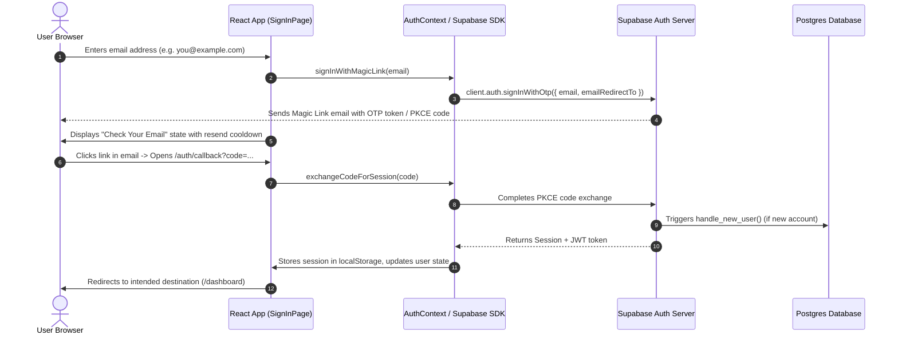

# Supabase Authentication Architecture & Implementation Specification

**Application:** My Work Planner  
**Authentication Method:** Passwordless Email Magic Link (OTP / PKCE)  
**SDK:** `@supabase/supabase-js` v2.119+  
**Platform Reference:** `tefxkrigwvyiescuctmb` (ap-northeast-1)  
**Client Environment:** React 19 + TypeScript + Vite + React Router v7  

---

## 1. Authentication Architecture Overview



---

## 2. Authentication Flow Details

### A. Sign In View (`SignInPage.tsx`)
1. **Initial Input State**:
   - Clean, centered Liquid Glass card.
   - Email format validation (`validateEmailFormat`) rejecting empty, malformed, or invalid domains before network requests.
   - Primary "Send Magic Link" action with spinner.
2. **"Check Your Email" Success State**:
   - Displays masked email address for visual confirmation.
   - 60-second countdown timer on "Resend Link" to prevent rate-limiting.
   - "Change email" button to reset the form.
3. **Redirect Memory**:
   - Saves `location.state.from.pathname` into `sessionStorage.setItem('auth_redirect_to', path)` so unauthenticated visitors are redirected back to their originally requested screen after signing in.

### B. Callback View (`AuthCallbackPage.tsx`)
1. **Error Detection**:
   - Checks both query string (`?error=...`) and hash fragments (`#error=...`) for expired or invalid link errors.
   - Renders a user-friendly error card with a 1-click button to return to `/sign-in`.
2. **PKCE Exchange & Token Detection**:
   - Reads `?code=...` query parameter and calls `supabase.auth.exchangeCodeForSession(code)`.
   - Also listens to `supabase.auth.onAuthStateChange` for hash-fragment token delivery (`detectSessionInUrl: true`).
3. **URL Sanitization & Destination Redirection**:
   - Strips code and auth parameters from window history (`window.history.replaceState`).
   - Retrieves `auth_redirect_to` from `sessionStorage` and navigates to the destination (default: `/dashboard`).

### C. Session Management (`AuthContext.tsx`)
1. **Initial Hydration**:
   - `supabase.auth.getSession()` resolves any persisted session from browser storage.
   - Resolves user profile from `public.profiles`.
   - Sets `isLoading: false` only after session resolution completes to eliminate flicker.
2. **Event Subscription**:
   - Subscribes via `supabase.auth.onAuthStateChange((event, newSession) => ...)`.
   - Handles `SIGNED_IN`, `TOKEN_REFRESHED`, `USER_UPDATED`, and `SIGNED_OUT`.
3. **Sign Out**:
   - Calls `supabase.auth.signOut()`.
   - Clears in-memory session, user, and profile states.
   - Triggering workspace context to wipe all cached tasks and projects.

### D. Protected Route Guard (`ProtectedRoute.tsx`)
- Wraps all workspace routes (`/dashboard`, `/tasks`, `/projects`, `/time-tracker`, `/reports`, `/settings`, `/calendar`).
- When `isLoading`: Displays a full-screen liquid glass session verification spinner.
- When unauthenticated in configured mode: Redirects to `/sign-in` with `state={{ from: location }}`.
- When authenticated: Renders requested screen.

---

## 3. Required Supabase Dashboard Settings

To ensure Magic Link authentication functions in development and production, configure the following in the Supabase Dashboard:

### 1. Site URL & Redirect URLs
- **Dashboard Path**: `Authentication` -> `URL Configuration`
- **Site URL**:
  ```
  http://localhost:3000
  ```
- **Redirect URLs** (Add both):
  ```
  http://localhost:3000/**
  http://localhost:3000/auth/callback
  ```

### 2. Email Provider Configuration
- **Dashboard Path**: `Authentication` -> `Providers` -> `Email`
- **Enable Email Provider**: `ON`
- **Confirm email**: `OFF` (for instant local testing) or `ON` (production)
- **OTP Expiry**: Default 3600 seconds (1 hour)
- **Allow Passwordless**: `ON`

---

## 4. Environment Variables Reference

```bash
# In .env.local
VITE_SUPABASE_URL="https://tefxkrigwvyiescuctmb.supabase.co"
VITE_SUPABASE_PUBLISHABLE_KEY="<your-publishable-key>"
VITE_APP_BASE_URL="http://localhost:3000"
```
