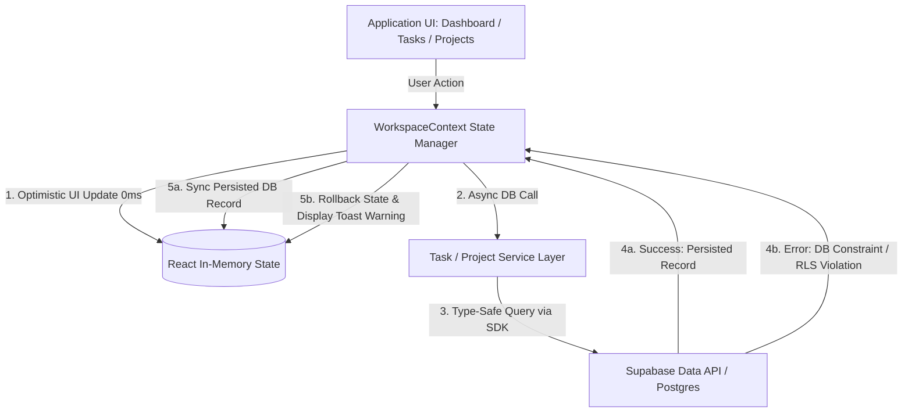

# Task & Project Database Integration Specification

**Milestone:** Milestone 4  
**Application:** My Work Planner  
**Database Tables:** `tasks`, `projects` (PostgreSQL 15+ via Supabase)  
**Service Layer:** `src/services/taskService.ts`, `src/services/projectService.ts`  
**State Architecture:** Optimistic UI Updates with Database Persistence & Rollback in `WorkspaceContext.tsx`  

---

## 1. Architectural Overview

---

## 2. Service Layer Architecture

### A. Task Service (`src/services/taskService.ts`)
| Function | Database Query | Business Rule Enforced |
| :--- | :--- | :--- |
| `fetchTasks(userId)` | `SELECT * FROM tasks WHERE user_id = $1` | Orders by `sort_order ASC, created_at DESC`. Maps snake_case DB columns to camelCase `Task` domain model. |
| `createTask(userId, values)` | `INSERT INTO tasks (...) VALUES (...)` | Enforces non-empty title. Start time requires scheduled date. Planned duration must be positive or null. |
| `updateTask(userId, taskId, values)` | `UPDATE tasks SET ... WHERE id = $taskId AND user_id = $userId` | Preserves existing fields, updates timestamps, respects multi-tenant boundaries. |
| `toggleTaskCompletion(userId, taskId, currentStatus)` | `UPDATE tasks SET status = $next, completed_at = $ts WHERE id = $taskId AND user_id = $userId` | Switches between `todo` and `completed`. Sets or clears `completed_at`. |
| `scheduleTask(userId, taskId, dateIso)` | `UPDATE tasks SET scheduled_date = $dateIso, scheduled_start_time = ... WHERE id = $taskId AND user_id = $userId` | Clearing scheduled date automatically clears start time (Rule 4). |
| `archiveTask(userId, taskId, isArchived)` | `UPDATE tasks SET is_archived = $isArchived WHERE id = $taskId AND user_id = $userId` | Soft-delete: preserves historical records and associated time logs. |
| `deleteTask(userId, taskId)` | `DELETE FROM tasks WHERE id = $taskId AND user_id = $userId` | Hard-delete: work sessions have foreign key `ON DELETE SET NULL`, preserving historical time tracked. |

### B. Project Service (`src/services/projectService.ts`)
| Function | Database Query | Business Rule Enforced |
| :--- | :--- | :--- |
| `fetchProjects(userId)` | `SELECT * FROM projects WHERE user_id = $1` | Orders by `created_at ASC`. Maps DB columns to domain `Project` model. |
| `createProject(userId, input)` | `INSERT INTO projects (...) VALUES (...)` | Requires non-empty name. Optional client name and description. |
| `updateProject(userId, projectId, input)` | `UPDATE projects SET ... WHERE id = $projectId AND user_id = $userId` | Updates name, description, client name, color. |
| `toggleArchiveProject(userId, projectId, isArchived)` | `UPDATE projects SET is_archived = $isArchived WHERE id = $projectId AND user_id = $userId` | Archives project without modifying tasks. |
| `deleteProject(userId, projectId)` | `DELETE FROM projects WHERE id = $projectId AND user_id = $userId` | Deletes project; associated tasks in `tasks` table have `project_id` automatically set to `NULL` via schema FK constraint. |

---

## 3. Task View Organization Rules

All task views derive their data dynamically from the central `tasks` collection:

1. **Inbox View (`tasks.filter(t => t.scheduledDate === null && !t.isArchived)`)**:
   - Holds unscheduled tasks.
   - When a user schedules an Inbox task, `scheduledDate` is set -> task automatically leaves Inbox and appears in Today or Upcoming.
   - When a scheduled task has its date removed, `scheduledDate` becomes `null` -> task automatically reappears in Inbox.
2. **Today View (`tasks.filter(t => t.scheduledDate === todayIso && !t.isArchived)`)**:
   - Displays tasks scheduled for the current calendar date in the user's timezone (`getLocalDateISO()`).
   - Also displays incomplete overdue tasks scheduled before today.
3. **Upcoming View (`tasks.filter(t => t.scheduledDate > todayIso && !t.isArchived)`)**:
   - Displays future scheduled tasks grouped by date.
4. **Dashboard View**:
   - Summarizes today's tasks count, completed vs remaining tasks, and next upcoming tasks.

---

## 4. Multi-Tenant Data Isolation & Security

1. **Client-Level Isolation**:
   - Every service call explicitly filters by `user_id = auth.uid()` in addition to database RLS policies.
   - On logout or user switch, `tasks`, `projects`, and `activeTimer` states are **immediately wiped** from memory.
2. **Database-Level Isolation (RLS)**:
   - RLS is enabled on all tables.
   - Policies verify `((select auth.uid()) = user_id)`.
   - Anonymous access is explicitly revoked.
   - Composite foreign keys guarantee that User A cannot assign a task to User B's project:
     `FOREIGN KEY (project_id, user_id) REFERENCES projects(id, user_id) ON DELETE SET NULL`.
