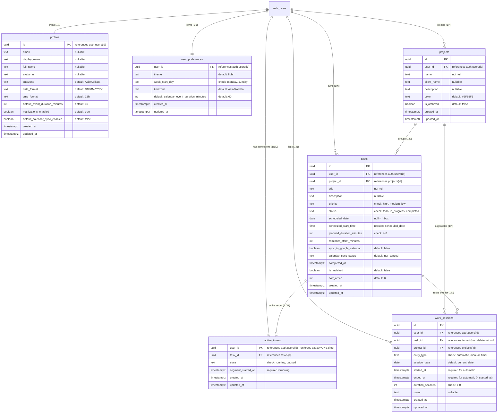

# Database Architecture & Schema Specification

**Application:** My Work Planner  
**Database Engine:** PostgreSQL 15+ (via Supabase)  
**Project Reference:** `tefxkrigwvyiescuctmb`  
**Migration Path:** `supabase/migrations/20261121000001_create_my_work_planner_schema.sql`  
**Security Model:** Mandatory Row Level Security (RLS) on 100% of tables  
**Test Suite:** `supabase/tests/00001_schema_and_rls_test.sql`

---

## 1. Entity Relationship Overview

---

## 2. Table Specifications

### A. `profiles`
Stores application-specific user profile data linked 1:1 with `auth.users`.
- `id` (`uuid`, Primary Key): References `auth.users(id)` with `ON DELETE CASCADE`.
- `email` (`text`, nullable): Mirrored email address for profile displays.
- `display_name` (`text`, nullable): User's chosen display name.
- `full_name` (`text`, nullable): User's full name (for compatibility).
- `avatar_url` (`text`, nullable): URL to profile photo.
- `timezone` (`text`, not null, default: `'Asia/Kolkata'`): User's configured timezone.
- `date_format` (`text`, not null, default: `'DD/MM/YYYY'`): Date display convention.
- `time_format` (`text`, not null, default: `'12h'`): 12-hour or 24-hour time formatting.
- `default_event_duration_minutes` (`integer`, not null, default: `60`, check `> 0`).
- `notifications_enabled` (`boolean`, not null, default: `true`).
- `default_calendar_sync_enabled` (`boolean`, not null, default: `false`).
- `created_at` / `updated_at` (`timestamptz`, default: `now()`).

### B. `projects`
Stores optional client projects used to organize and categorize tasks.
- `id` (`uuid`, Primary Key, default: `gen_random_uuid()`).
- `user_id` (`uuid`, not null): References `auth.users(id)` with `ON DELETE CASCADE`.
- `name` (`text`, not null): Human-readable project name.
- `client_name` (`text`, nullable): Client or company tag.
- `description` (`text`, nullable): Scope or context notes.
- `color` (`text`, not null, default: `'#2F65F6'`): Hex color swatch for UI pills.
- `is_archived` (`boolean`, not null, default: `false`): Project archive flag.
- `created_at` / `updated_at` (`timestamptz`, default: `now()`).
- **Constraints**: `UNIQUE (id, user_id)` enables multi-tenant composite foreign keys.

### C. `tasks`
Core task repository supporting Inbox (unscheduled) and scheduled day planner views.
- `id` (`uuid`, Primary Key, default: `gen_random_uuid()`).
- `user_id` (`uuid`, not null): References `auth.users(id)` with `ON DELETE CASCADE`.
- `project_id` (`uuid`, nullable): References `projects(id)` with `ON DELETE SET NULL`.
- `title` (`text`, not null): Task title.
- `description` (`text`, nullable): Markdown notes or details.
- `priority` (`text`, not null, default: `'medium'`): Check `IN ('high', 'medium', 'low')`.
- `status` (`text`, not null, default: `'todo'`): Check `IN ('todo', 'in_progress', 'completed')`.
- `scheduled_date` (`date`, nullable): When `NULL`, task belongs to Inbox. When set, task belongs to that day.
- `scheduled_start_time` (`time`, nullable): Time of day; requires `scheduled_date` to be non-null.
- `planned_duration_minutes` (`integer`, nullable): Estimated duration in minutes; check `planned_duration_minutes > 0`.
- `reminder_offset_minutes` (`integer`, nullable): Lead time for notifications.
- `sync_to_google_calendar` (`boolean`, not null, default: `false`).
- `calendar_sync_status` (`text`, not null, default: `'not_synced'`).
- `completed_at` (`timestamptz`, nullable): Timestamp when task was marked completed.
- `is_archived` (`boolean`, not null, default: `false`): Archive flag.
- `sort_order` (`integer`, not null, default: `0`).
- `created_at` / `updated_at` (`timestamptz`, default: `now()`).
- **Composite Unique**: `UNIQUE (id, user_id)` for multi-tenant safety.
- **Cross-Tenant Constraint**: Composite FK `FOREIGN KEY (project_id, user_id) REFERENCES projects(id, user_id) ON DELETE SET NULL` guarantees a user can never assign a task to another user's project.

#### Task Business Rules Enforced in Database:
1. **Inbox State**: `scheduled_date IS NULL` defines an Inbox task.
2. **Scheduled State**: `scheduled_date IS NOT NULL` defines a scheduled task.
3. **Start Time Dependency**: `CONSTRAINT check_task_start_time_requires_date CHECK (scheduled_start_time IS NULL OR scheduled_date IS NOT NULL)`.
4. **Auto-Clear Start Time Trigger**: Trigger `tr_tasks_scheduling_rules` executes before insert or update: if `NEW.scheduled_date IS NULL`, it automatically resets `NEW.scheduled_start_time := NULL`.
5. **Positive Duration**: `CHECK (planned_duration_minutes IS NULL OR planned_duration_minutes > 0)`.

### D. `work_sessions`
Historical time logs consisting of completed automatic timer segments and manual entries.
- `id` (`uuid`, Primary Key, default: `gen_random_uuid()`).
- `user_id` (`uuid`, not null): References `auth.users(id)` with `ON DELETE CASCADE`.
- `task_id` (`uuid`, nullable): References `tasks(id)` with `ON DELETE SET NULL`.
- `project_id` (`uuid`, nullable): References `projects(id)` with `ON DELETE SET NULL`.
- `entry_type` (`text`, not null, default: `'automatic'`): Check `IN ('automatic', 'manual', 'timer')`.
- `session_date` (`date`, not null, default: `current_date`): Date of the work session for daily reporting.
- `started_at` (`timestamptz`, nullable): Start timestamp.
- `ended_at` (`timestamptz`, nullable): End timestamp.
- `duration_seconds` (`integer`, not null): Persisted duration; check `duration_seconds > 0`.
- `notes` (`text`, nullable): Work summary notes.
- `created_at` / `updated_at` (`timestamptz`, default: `now()`).

#### Safe Relationship & Historical Preservation Strategy:
- When a task is archived (`is_archived = true`), `task_id` remains linked and session history is preserved.
- When a task is deleted, the foreign key uses `ON DELETE SET NULL`. The historical work session record is **NEVER deleted**; its `duration_seconds`, `session_date`, and `user_id` remain intact so time reports and billing history remain accurate.
- Automatic sessions require valid start and end timestamps where `ended_at > started_at`.

### E. `active_timers`
Persists the single global active timer per user across browser sessions, device reloads, and tab switches.
- `user_id` (`uuid`, Primary Key): References `auth.users(id)` with `ON DELETE CASCADE`.
  - **Single Active Timer Rule**: Setting `user_id` as the primary key strictly enforces that a user can have **at most one** active timer row in the entire database.
- `task_id` (`uuid`, not null): References `tasks(id)` with `ON DELETE CASCADE`.
- `state` (`text`, not null): Check `IN ('running', 'paused')`.
- `segment_started_at` (`timestamptz`, nullable): Timestamp when the current running segment started.
- `created_at` / `updated_at` (`timestamptz`, default: `now()`).
- **Composite Foreign Key**: `(task_id, user_id) REFERENCES tasks(id, user_id) ON DELETE CASCADE` ensures a user cannot bind a timer to another user's task.
- **State Check**: `CHECK ((state = 'running' AND segment_started_at IS NOT NULL) OR (state = 'paused'))`.

### F. `user_preferences`
Stores persistent user-level workspace preferences.
- `user_id` (`uuid`, Primary Key): References `auth.users(id)` with `ON DELETE CASCADE`.
- `theme` (`text`, not null, default: `'light'`).
- `week_start_day` (`text`, not null, default: `'monday'`, check: `IN ('monday', 'sunday')`).
- `timezone` (`text`, not null, default: `'Asia/Kolkata'`).
- `default_calendar_event_duration_minutes` (`integer`, not null, default: `60`, check `> 0`).
- `created_at` / `updated_at` (`timestamptz`, default: `now()`).

---

## 3. Row Level Security (RLS) Policy Matrix

RLS is enabled on **all 6 tables**. All policies:
- Target `TO authenticated` directly (avoiding deprecated `auth.role()`).
- Wrap `(select auth.uid())` in subqueries for single-evaluation performance caching per query.
- Include both `USING` and `WITH CHECK` for `UPDATE` operations to prevent tenant reassignment attacks.
- Have default `anon` permissions revoked.

| Table | Operation | Target Role | Policy Definition |
| :--- | :--- | :--- | :--- |
| `profiles` | SELECT | `authenticated` | `USING ((select auth.uid()) = id)` |
| `profiles` | INSERT | `authenticated` | `WITH CHECK ((select auth.uid()) = id)` |
| `profiles` | UPDATE | `authenticated` | `USING ((select auth.uid()) = id) WITH CHECK ((select auth.uid()) = id)` |
| `profiles` | DELETE | `authenticated` | `USING ((select auth.uid()) = id)` |
| `projects` | SELECT | `authenticated` | `USING ((select auth.uid()) = user_id)` |
| `projects` | INSERT | `authenticated` | `WITH CHECK ((select auth.uid()) = user_id)` |
| `projects` | UPDATE | `authenticated` | `USING ((select auth.uid()) = user_id) WITH CHECK ((select auth.uid()) = user_id)` |
| `projects` | DELETE | `authenticated` | `USING ((select auth.uid()) = user_id)` |
| `tasks` | SELECT | `authenticated` | `USING ((select auth.uid()) = user_id)` |
| `tasks` | INSERT | `authenticated` | `WITH CHECK ((select auth.uid()) = user_id)` |
| `tasks` | UPDATE | `authenticated` | `USING ((select auth.uid()) = user_id) WITH CHECK ((select auth.uid()) = user_id)` |
| `tasks` | DELETE | `authenticated` | `USING ((select auth.uid()) = user_id)` |
| `work_sessions` | SELECT | `authenticated` | `USING ((select auth.uid()) = user_id)` |
| `work_sessions` | INSERT | `authenticated` | `WITH CHECK ((select auth.uid()) = user_id)` |
| `work_sessions` | UPDATE | `authenticated` | `USING ((select auth.uid()) = user_id) WITH CHECK ((select auth.uid()) = user_id)` |
| `work_sessions` | DELETE | `authenticated` | `USING ((select auth.uid()) = user_id)` |
| `active_timers` | SELECT | `authenticated` | `USING ((select auth.uid()) = user_id)` |
| `active_timers` | INSERT | `authenticated` | `WITH CHECK ((select auth.uid()) = user_id)` |
| `active_timers` | UPDATE | `authenticated` | `USING ((select auth.uid()) = user_id) WITH CHECK ((select auth.uid()) = user_id)` |
| `active_timers` | DELETE | `authenticated` | `USING ((select auth.uid()) = user_id)` |
| `user_preferences` | SELECT | `authenticated` | `USING ((select auth.uid()) = user_id)` |
| `user_preferences` | INSERT | `authenticated` | `WITH CHECK ((select auth.uid()) = user_id)` |
| `user_preferences` | UPDATE | `authenticated` | `USING ((select auth.uid()) = user_id) WITH CHECK ((select auth.uid()) = user_id)` |
| `user_preferences` | DELETE | `authenticated` | `USING ((select auth.uid()) = user_id)` |

---

## 4. Performance Indexes

| Index Name | Table | Columns Indexed | Purpose |
| :--- | :--- | :--- | :--- |
| `idx_projects_user_id` | `projects` | `(user_id)` | Foreign key lookups & RLS policy evaluation |
| `idx_projects_user_archived` | `projects` | `(user_id, is_archived)` | Filtering active projects in sidebar/selects |
| `idx_tasks_user_id` | `tasks` | `(user_id)` | Foreign key lookups & RLS policy evaluation |
| `idx_tasks_project_id` | `tasks` | `(project_id)` | Foreign key JOINs |
| `idx_tasks_user_scheduled` | `tasks` | `(user_id, scheduled_date)` | Daily Today view and Upcoming calendar queries |
| `idx_tasks_user_status` | `tasks` | `(user_id, status)` | Fast counts for completed vs pending tasks |
| `idx_tasks_user_archived` | `tasks` | `(user_id, is_archived)` | Excludes archived tasks across all views |
| `idx_work_sessions_user_id` | `work_sessions` | `(user_id)` | Foreign key lookups & RLS policy evaluation |
| `idx_work_sessions_task_id` | `work_sessions` | `(task_id)` | Aggregating saved seconds per task |
| `idx_work_sessions_project_id` | `work_sessions` | `(project_id)` | Aggregating tracked time per project |
| `idx_work_sessions_user_date` | `work_sessions` | `(user_id, session_date)` | Daily / weekly / monthly report time aggregations |
| `idx_work_sessions_user_started` | `work_sessions` | `(user_id, started_at)` | Chronological time entries list |
| `idx_active_timers_task_id` | `active_timers` | `(task_id)` | Foreign key JOIN for active task details |

---

## 5. Automated Database Triggers

1. **`update_updated_at_column()`**:
   - Maintains accurate `updated_at` timestamps on row updates.
   - Assigned to: `profiles`, `projects`, `tasks`, `work_sessions`, `active_timers`, `user_preferences`.
   - `SECURITY INVOKER`, explicit `SET search_path = public`.
2. **`handle_task_scheduling_rules()`**:
   - Enforces Business Rule 4: resets `scheduled_start_time` to `NULL` whenever `scheduled_date` is removed.
   - `BEFORE INSERT OR UPDATE` on `tasks`.
3. **`handle_new_user()`**:
   - Attached to `AFTER INSERT ON auth.users`.
   - Automatically provisions initial `profiles` and `user_preferences` rows for every newly registered user.
   - `SECURITY DEFINER`, explicit `SET search_path = public`.
   - Wrapped in an exception handler so it cannot break user sign-up if an edge-case error occurs.

---

## 6. Atomic Stored Procedures & RPC Operations (Milestone 5)

Defined in `supabase/migrations/20261121000002_timer_rpc_operations.sql`:

| Function | Parameters | Return | Security & Grants | Description |
|---|---|---|---|---|
| `rpc_start_timer` | `p_task_id uuid` | `jsonb` | `SECURITY DEFINER`, `authenticated` | Starts focus timer or resumes existing paused session; promotes `todo` to `in_progress`. |
| `rpc_pause_timer` | (none) | `jsonb` | `SECURITY DEFINER`, `authenticated` | Commits current running segment to `work_sessions` and sets state to `paused`. |
| `rpc_resume_timer` | (none) | `jsonb` | `SECURITY DEFINER`, `authenticated` | Starts fresh running segment without losing previous sessions. |
| `rpc_stop_timer` | (none) | `jsonb` | `SECURITY DEFINER`, `authenticated` | Closes running segment (if active) and removes `active_timers` record. |
| `rpc_switch_timer` | `p_new_task_id uuid` | `jsonb` | `SECURITY DEFINER`, `authenticated` | Atomically commits previous task session and switches active timer to new task. |
| `rpc_complete_task_with_timer` | `p_task_id uuid` | `jsonb` | `SECURITY DEFINER`, `authenticated` | Commits active segment, clears timer, and marks task `completed`. |

