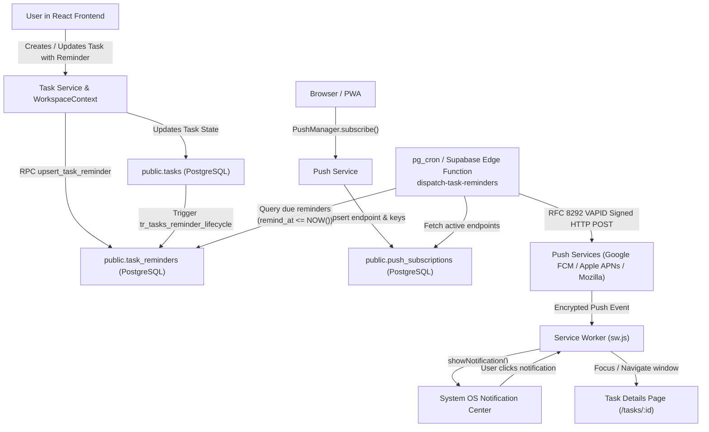

# My Work Planner — Notifications Architecture

## Overview

My Work Planner implements an end-to-end task reminder and push notification system built on standard W3C Web Push protocols (RFC 8292 VAPID, RFC 8291 AES-128-GCM payload encryption), Supabase PostgreSQL persistence, and Supabase Edge Functions.

---

## 1. System Architecture

---

## 2. Push Notification Subscription Flow

1. **Permission Request**:
   The user clicks **Enable Push Notifications** in Settings (`src/features/settings/SettingsPage.tsx`).
2. **Browser PushManager**:
   `pushService.subscribe()` calls `registration.pushManager.subscribe()` using `urlBase64ToUint8Array(VITE_VAPID_PUBLIC_KEY)`.
3. **Key Extraction**:
   The browser returns a `PushSubscription` containing:
   - `endpoint`: Device push gateway URL.
   - `p256dh`: Client public key (65 bytes uncompressed P-256).
   - `auth`: Client 16-byte authentication secret.
4. **Database Persistence**:
   Upserted into `public.push_subscriptions` keyed on `(user_id, endpoint)`. If a user logs into multiple devices (laptop, tablet, phone), each device receives a distinct row.

---

## 3. Server-Side Dispatcher (`dispatch-task-reminders`)

Deployed at: `https://tefxkrigwvyiescuctmb.supabase.co/functions/v1/dispatch-task-reminders`

### A. Execution Modes
1. **Direct Test Mode (`{ "test": true }`)**:
   - Authorized via Bearer token.
   - Dispatches a test notification to all active devices of the caller.
2. **Scheduled Due Reminders Mode**:
   - Queries `task_reminders` where `status = 'scheduled'` and `remind_at <= NOW()`.
   - Joins with `tasks` to verify task is still active (not completed, not archived, scheduled date present).
   - Encrypts payload via pure Web Crypto AES-128-GCM and signs authorization token with VAPID P-256 private key.
   - Dispatches HTTP POST to each subscriber endpoint.
   - Automatically prunes dead subscriptions returning HTTP 404 / 410.
   - Updates reminder `status = 'sent'` and bumps `attempt_count`.

---

## 4. Business Invariants & Lifecycle Rules

1. **Inbox Tasks**: Tasks with `scheduled_date = null` can never have reminders.
2. **Date-Only Tasks**: Tasks with a date but no start time require an explicit reminder time (e.g. 09:00). Reminders NEVER default to midnight (00:00).
3. **Automatic Cancellation**: Completing a task, archiving it, or moving it to Inbox triggers `handle_task_reminder_lifecycle()` which sets pending reminders to `'cancelled'`.
4. **Rescheduling**: Changing a task's date or start time recalculates `remind_at` and updates the scheduled reminder.
5. **Reopening**: Reopening a completed task recreates the reminder if the calculated `remind_at` is in the future.
