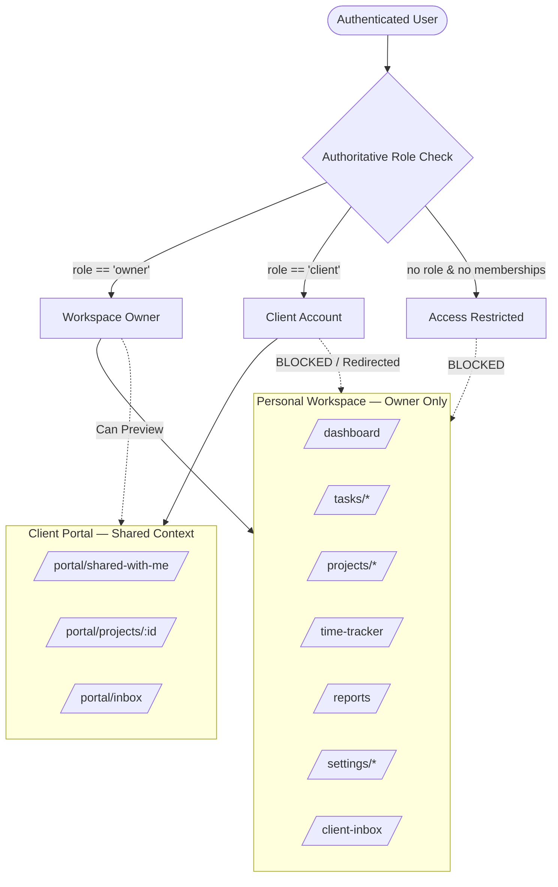

# My Work Planner — Owner vs Client Access & Authorization Architecture

## 1. Executive Summary

My Work Planner was initially built as an individual personal productivity and time-tracking application. With the introduction of Milestone 10 (Project Sharing and Client Portal), external collaborators and clients were invited into specific shared projects.

Prior to Milestone 11, a critical authorization defect existed:
1. Authentication was treated as equivalent to workspace ownership.
2. The wildcard frontend router (`/*`) defaulted to rendering the owner's personal workspace (`AppShell`) containing `Dashboard`, `My Tasks`, `Projects`, `Time Tracker`, `Reports`, and `Settings`.
3. PostgreSQL Row-Level Security (RLS) allowed any authenticated user (`auth.uid() = user_id`) to insert tasks and projects, inadvertently granting clients pseudo-owner capabilities.

This document outlines the security architecture implemented in **Milestone 11** to guarantee mathematical, end-to-end separation between the Workspace Owner and external Client accounts.

---

## 2. Authorization Hierarchy & Roles



### Role Definitions

| Role | Database Source of Truth | Permitted Routes | Write Permissions |
| :--- | :--- | :--- | :--- |
| **`owner`** | `public.workspace_roles.role = 'owner'` | `/dashboard`, `/tasks/*`, `/projects/*`, `/time-tracker`, `/reports`, `/settings/*`, `/client-inbox`, `/portal/*` (preview) | Full CRUD on `projects`, `tasks`, `work_sessions`, `active_timers`, `project_invitations`, `project_updates`. |
| **`client`** | `public.workspace_roles.role = 'client'` OR accepted `public.project_members` | `/portal`, `/portal/projects/:id`, `/portal/inbox` | Read shared projects and client-visible tasks. Create project comments and replies. **Zero** task, project, timer, or session write access. |
| **`unauthorized`** | Authenticated without owner role or accepted membership | `/invite/:token`, Sign Out | **Zero** access to owner workspace. Prompted with invitation guidance. |

---

## 3. Database Layer: Multi-Tiered Security Definer Enforcement

All security is authoritatively enforced at the PostgreSQL database level using Row-Level Security (RLS) and Security Definer Functions. Frontend route guards exist strictly for user experience; bypassing the frontend is impossible because the database denies all unauthorized operations.

### 3.1 `workspace_roles` Table & Immutable RLS
```sql
create table if not exists public.workspace_roles (
  id uuid primary key default gen_random_uuid(),
  user_id uuid not null references auth.users(id) on delete cascade unique,
  role text not null check (role in ('owner', 'client')),
  created_at timestamptz not null default now(),
  updated_at timestamptz not null default now()
);

-- Deny all authenticated direct inserts/updates/deletes
create policy "workspace_roles_deny_authenticated_insert" on public.workspace_roles for insert to authenticated with check (false);
create policy "workspace_roles_deny_authenticated_update" on public.workspace_roles for update to authenticated using (false);
create policy "workspace_roles_deny_authenticated_delete" on public.workspace_roles for delete to authenticated using (false);
```

### 3.2 Security Definer Helper: `is_workspace_owner()`
```sql
create or replace function public.is_workspace_owner(p_user_id uuid default auth.uid())
returns boolean language sql security definer set search_path = public stable as $$
  select exists (
    select 1
    from public.workspace_roles
    where user_id = p_user_id
      and role = 'owner'
  );
$$;
```

### 3.3 Strict Owner-Only Writes on Projects, Tasks, and Work Sessions
Any attempt by a client account to issue `INSERT`, `UPDATE`, or `DELETE` on `projects`, `tasks`, `work_sessions`, or `active_timers` is rejected by PostgreSQL RLS:
```sql
alter table public.projects enable row level security;

create policy "projects_insert_own" on public.projects for insert to authenticated
  with check (
    public.is_workspace_owner((select auth.uid()))
    and (select auth.uid()) = user_id
  );

create policy "projects_update_own" on public.projects for update to authenticated
  using (
    public.is_workspace_owner((select auth.uid()))
    and (select auth.uid()) = user_id
  );

create policy "projects_delete_own" on public.projects for delete to authenticated
  using (
    public.is_workspace_owner((select auth.uid()))
    and (select auth.uid()) = user_id
  );
```
*(Identical policies protect `public.tasks`, `public.work_sessions`, and `public.active_timers`).*

---

## 4. Frontend Route Architecture (`OwnerRoute` & `ClientPortalRoute`)

### 4.1 Route Guard Topology
1. **`OwnerRoute`**:
   - Inspects `isAuthenticated` and `isOwner`.
   - If `isClient && !isOwner`: intercepts navigation and redirects to `/portal`.
   - If unverified/unauthorized: renders `<AccessRestrictedScreen>` with sign-out and invitation instructions.
   - If `isOwner`: renders children inside `AppShell`.
2. **`ClientPortalRoute`**:
   - Inspects `isAuthenticated` and `(isClient || isOwner)`.
   - Allows both clients and the owner (for client portal preview).
   - If an account has 0 accepted memberships and no owner role: displays an informational screen explaining that no projects are shared with this account.
3. **`RootRedirect` (`/`)**:
   - Unauthenticated: redirects to `/sign-in`.
   - Authenticated Owner: redirects to `/dashboard`.
   - Authenticated Client: redirects to `/portal`.

### 4.2 UI Navbar Isolation
In `ClientPortalLayout.tsx`:
- The "Personal Workspace" button (`/dashboard`) is conditionally rendered **strictly** when `isOwner === true`.
- External clients never see links or shortcuts to the owner workspace.

---

## 5. Verification Matrix

| Scenario | Tested Result | Enforcement Layer |
| :--- | :--- | :--- |
| Client navigates to `/dashboard` | Redirected immediately to `/portal` | Frontend `OwnerRoute` |
| Client directly queries `supabase.from('tasks').insert(...)` | PostgreSQL returns `permission denied for table tasks` (RLS check violation) | Database PostgreSQL RLS |
| Client visits `/portal` | Loads only projects where user has accepted membership in `project_members` | RLS `projects_read_shared` + RPC |
| Owner visits `/portal` | Permitted to preview all client-facing project interfaces | RLS `projects_read_own` |
| New invitee opens `/invite/:token` | Details previewed via `rpc_get_invitation_preview`, accepted via `rpc_accept_project_invitation` | Security Definer RPCs |
