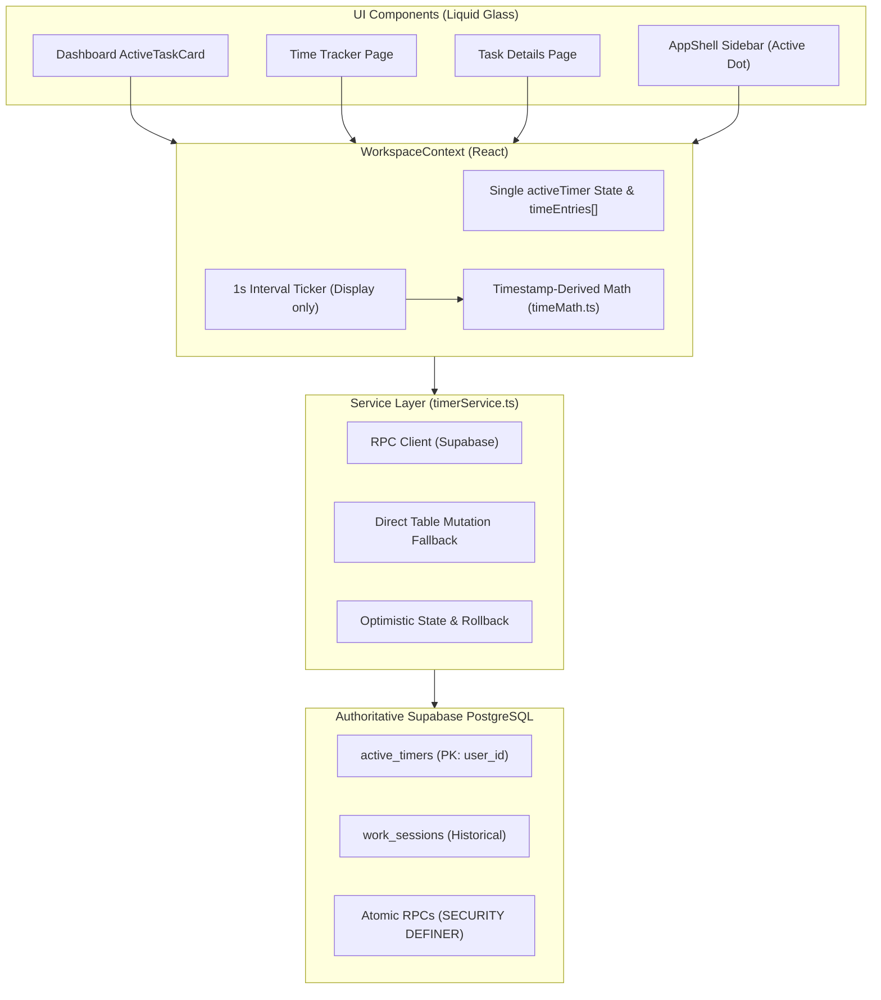

# Time Tracking Architecture — My Work Planner

This document provides a comprehensive technical overview of the persistent, high-reliability time-tracking architecture in **My Work Planner** implemented as part of **Milestone 5**.

---

## 1. Architectural Philosophy & Invariants

Time tracking is one of the most critical features in *My Work Planner*. Historical productivity logs and live focus tracking must remain accurate, resilient, and non-destructive under all operational scenarios.

### Core Architectural Invariants:
1. **Single Global Active Timer Per User**:
   - A user can work on many tasks, but may run **strictly at most one active timer** at any point in time across all devices, windows, and tabs.
   - Enforced at the database level with a primary key constraint: `active_timers (user_id UUID PRIMARY KEY)`.
2. **Database as Authoritative Source of Truth**:
   - Client clock drift, browser tab throttling (timers throttled to once per minute or paused in background), and page reloads cannot compromise duration accuracy.
   - The authoritative elapsed time of a running segment is calculated strictly from server timestamps: `now() - segment_started_at`.
3. **Strict Separation of Timer State and Task Status**:
   - **Timer States**: `Idle` (no record in `active_timers`), `Running` (`state = 'running'`), `Paused` (`state = 'paused'`), and `Recovering`.
   - **Task Statuses**: `To Do`, `In Progress`, `Completed`.
   - Stopping a timer does NOT mark the task completed (it remains `in_progress`). Completing a task intercepts any running timer and safely closes the session.
4. **Non-Destructive Work Session History**:
   - Historical work sessions in `work_sessions` are permanent productivity logs.
   - Foreign key constraint: `work_sessions.task_id REFERENCES tasks(id, user_id) ON DELETE SET NULL`. Deleting a task keeps all historical logged work intact for weekly/monthly analytics and reports.
5. **Zero Double-Counting**:
   - Completed segments are written to `work_sessions`.
   - Running segments are tracked dynamically via `active_timers.segment_started_at`.
   - Paused segments are committed to `work_sessions` immediately on pause, resetting `segment_started_at` to `NULL`.
   - `Live Actual = Saved Work Time + Current Active Session`.

---

## 2. Canonical Time Calculation Definitions

| Metric | Definition | Implementation Formula |
|---|---|---|
| **Saved Work Time** | Sum of all completed automatic and manual sessions for a task or date filter. | `sum(duration_seconds)` for all matching `work_sessions` where `status = 'completed'` |
| **Current Active Session** | Elapsed duration of the current Running segment only. 0 when paused or idle. | `max(0, floor((nowMs - startedAtMs) / 1000))` if `status === 'running'` else `0` |
| **Live Actual Time** | Total real-time effort invested into a task. | `Saved Work Time + Current Active Session` |
| **Variance (Planned vs Actual)** | Deviation of actual time from estimated duration. | `Actual Seconds - Planned Seconds`<br/>• `delta < -60s`: Under Plan<br/>• `|delta| <= 60s`: On Target<br/>• `delta > +60s`: Over Plan<br/>• No estimate: No Estimate |

---

## 3. Database Schema Overview

### 3.1 `active_timers` Table
```sql
create table if not exists public.active_timers (
  user_id uuid primary key references auth.users(id) on delete cascade,
  task_id uuid not null,
  state text not null check (state in ('running', 'paused')),
  segment_started_at timestamptz,
  created_at timestamptz not null default now(),
  updated_at timestamptz not null default now(),

  constraint active_timers_task_user_fkey foreign key (task_id, user_id)
    references public.tasks(id, user_id) on delete cascade,

  constraint check_active_timer_running_segment check (
    (state = 'running' and segment_started_at is not null)
    or
    (state = 'paused')
  )
);
```

### 3.2 `work_sessions` Table
```sql
create table if not exists public.work_sessions (
  id uuid primary key default gen_random_uuid(),
  user_id uuid not null references auth.users(id) on delete cascade,
  task_id uuid,
  project_id uuid,
  entry_type text not null default 'automatic' check (entry_type in ('automatic', 'manual', 'timer')),
  session_date date not null default current_date,
  started_at timestamptz,
  ended_at timestamptz,
  duration_seconds integer not null check (duration_seconds > 0),
  notes text,
  created_at timestamptz not null default now(),
  updated_at timestamptz not null default now(),

  constraint work_sessions_task_user_fkey foreign key (task_id, user_id)
    references public.tasks(id, user_id) on delete set null,

  constraint work_sessions_project_user_fkey foreign key (project_id, user_id)
    references public.projects(id, user_id) on delete set null
);
```

---

## 4. Frontend State & Synchronization Model



1. **Hydration**: When authenticated, `loadUserData(userId)` runs concurrent queries for `tasks`, `projects`, `timerService.fetchActiveTimer(userId)`, and `timerService.fetchWorkSessions(userId)`.
2. **Optimistic Updates**: Timer actions (Start, Pause, Resume, Stop, Switch, Complete) immediately update React state with timestamp calculations.
3. **Rollback Resilience**: If a network error or rejection occurs, the UI rolls back cleanly to previous state and emits a clear toast notification.
4. **Preview Mode**: When running without configured Supabase credentials (Milestone 0 preview), the context falls back gracefully to in-memory state so local testing never halts.
