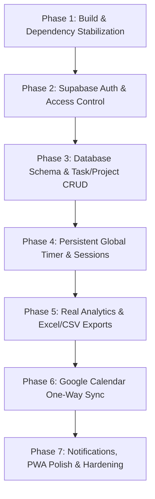

# Codebase Audit & Architectural Assessment — My Work Planner PWA

**Date:** November 20, 2026  
**Auditor:** Senior Full-Stack Engineer, Software Architect & UI/UX Implementation Specialist  
**Target Repository:** `my-work-planner-pwa`  
**Current Milestone:** Milestone 0 (Architecture, Design System & AppShell Foundation)  
**Audit Scope:** Read-Only Codebase Audit & Verification

---

## Executive Summary

**My Work Planner PWA** is a focused, single-user progressive web application designed for personal daily planning, task execution, and work time tracking. The project originated from Google AI Studio and was structured around `My_Work_Planner_PRD_v1.2.md` and the canonical `DESIGN.md` specification.

The codebase currently stands in a **clean, highly structured Milestone 0 state**. The application architecture, component hierarchy, design tokens, responsive AppShell, domain calculations, and unit tests are well-engineered. However, all application data (tasks, projects, work sessions, timer, and profile) is currently managed through an **in-memory React state (`WorkspaceContext.tsx`)** seeded with isolated preview fixtures (`previewData.ts`).

### Key Status Takeaways
1. **Application Shell & UI:** Fully implemented across Desktop (232px sidebar), Tablet (collapsible drawer), and Mobile (bottom navigation + sticky active timer). All primary routes are active.
2. **Domain Math & Integrity:** Pure functions for duration calculation, timestamp-driven timer math, overdue task detection, and input validation are implemented in `src/lib/timeMath.ts` and pass **9 out of 9 automated unit tests**.
3. **Timer Persistence:** The timer uses accurate timestamp math (`accumulated + (now - start)`), preventing browser interval drift. However, **active timer state currently lives only in React memory** and resets on browser reload.
4. **Backend & Database:** Client and server configuration skeletons exist (`src/lib/supabaseClient.ts`, `server/config/supabaseServer.ts`), but **no database tables, RLS policies, or Supabase queries are active**.
5. **Build & Package Management:** An upstream dependency resolution conflict exists between `vite@8.3.0` and `esbuild@^0.25.0` in `package.json`, and `bun.lock` has a version format issue with Bun 1.3.14. `node_modules` is not yet installed in the workspace.
6. **External Integrations:** Google Calendar, Email Magic Link authentication, and Excel/CSV exports are represented with **honest disconnected/milestone-bound disclosure states** in the UI, with zero fabricated data or bypass shortcuts.

---

## 1. Existing Technology Stack & Architecture

### Core Dependencies
| Category | Technology | Version in `package.json` | Notes |
|---|---|---|---|
| **Frontend Framework** | React | `19.0.1` | Modern React 19 root with strict mode |
| **DOM Renderer** | React DOM | `19.0.1` | Client-side hydration / rendering |
| **Routing** | React Router DOM | `7.18.6` | Client-side routing with `BrowserRouter` |
| **Build Tooling** | Vite | `^8.3.0` | Fast ESM-based dev server and bundler |
| **CSS & Styling** | Tailwind CSS v4 | `^4.3.3` | `@tailwindcss/vite` plugin, `@theme` variables |
| **Icons** | Lucide React | `^0.546.0` | Consistent 16–20px UI iconography |
| **Type System** | TypeScript | `^7.0.2` | Configured with `moduleResolution: bundler` |
| **Database SDK** | `@supabase/supabase-js` | `^2.119.2` | Supabase v2 client library |
| **Runtime / Package** | Node.js / Bun | Node `v22.23.1`, Bun `1.3.14` | Dual engine support |
| **Unused / Legacy** | `@google/genai` | `^2.4.0` | Present in `package.json`, unused in code |
| **Unused / Legacy** | `motion` | `^12.23.24` | Present in `package.json`, unused in code |
| **Unused / Legacy** | `express` | `^4.21.2` | Present in `package.json`, no server file yet |

### Build & TypeScript Configuration
- **Vite Configuration (`vite.config.ts`):**
  - Uses `@vitejs/plugin-react` and `@tailwindcss/vite`.
  - Configures `@/` path alias pointing to root.
  - Custom plugin `copy-unbundled-src-assets` preserves `src/assets` in `dist/`.
  - Configures HMR conditional disable flag (`DISABLE_HMR`).
- **TypeScript Configuration (`tsconfig.json`):**
  - Target: `ES2022`, Module: `ESNext`, Module Resolution: `bundler`.
  - Path mapping: `"@/*": ["./*"]`.
  - `noEmit: true`, `skipLibCheck: true`.
- **CSS Architecture (`src/index.css`):**
  - Fully implements canonical `DESIGN.md` tokens via `@theme`.
  - Palette: Canvas (`#F6F7F9`), Surface (`#FFFFFF`), Primary Accent (`#4968D6`), Success (`#16845B`), Warning (`#B7791F`), Danger (`#C2414B`), Info (`#3574B8`).
  - Strict `.tabular-nums-strict` rule (`font-variant-numeric: tabular-nums lining-nums; font-feature-settings: "tnum" 1, "lnum" 1`).
  - Mobile safe area utilities (`.pb-safe`, `.bottom-nav-offset`).
  - Prefers-reduced-motion media query.

---

## 2. Current Project Structure

```text
my-work-planner/
├── .env.example                         # Comprehensive env variables template
├── .gitignore                           # Ignores .env*, node_modules, build, dist, logs
├── bun.lock                             # Bun lockfile (v2 format)
├── docs/
│   ├── ARCHITECTURE.md                  # Architectural overview and invariants
│   ├── IMPLEMENTATION_NOTES.md          # PRD vs Stitch conflict resolutions
│   ├── IMPLEMENTATION_PLAN.md           # Milestones 0 through 7 roadmap
│   └── ANTIGRAVITY_CODEBASE_AUDIT.md    # This audit report
├── index.html                           # App entry HTML with viewport & PWA meta
├── package.json                         # Scripts & dependency definitions
├── public/
│   ├── apple-touch-icon.png             # 180x180 iOS home screen icon
│   ├── icon.svg                         # Vector brand mark
│   ├── manifest.webmanifest             # Standard PWA manifest
│   ├── pwa-192x192.png                  # Standard 192px icon
│   ├── pwa-512x512.png                  # Standard 512px icon
│   ├── pwa-maskable-512x512.png         # Maskable 512px icon
│   ├── sw.js                            # App-shell service worker
│   └── assets/aistudio/                 # Reference PRD, DESIGN.md, and Stitch exports
├── server/
│   └── config/
│       ├── env.ts                       # Server-only environment boundary
│       └── supabaseServer.ts            # Server-only privileged Supabase client factory
├── src/
│   ├── App.tsx                          # App root with Router, AuthProvider, WorkspaceProvider
│   ├── main.tsx                         # Entrypoint registering SW & rendering App
│   ├── index.css                        # Tailwind v4 theme and custom utilities
│   ├── components/
│   │   ├── layout/
│   │   │   └── AppShell.tsx             # Responsive shell (Desktop sidebar, Mobile bottom nav)
│   │   ├── pwa/
│   │   │   ├── OfflineIndicator.tsx     # Offline network warning banner
│   │   │   └── PWAInstallButton.tsx     # Native install prompt trigger
│   │   ├── tasks/
│   │   │   ├── TaskFormDrawer.tsx       # Create / edit task drawer with validation
│   │   │   └── TaskRow.tsx              # Task item with timer controls and planned vs actual
│   │   ├── timer/
│   │   │   ├── ActiveTimerCard.tsx      # Main timer display (Idle, Running, Paused, Recovering)
│   │   │   ├── ManualTimeEntryModal.tsx # Manual work session logger (duration or range)
│   │   │   └── TimerConfirmationModals.tsx # "Save & Switch" and "Stop & Complete" modals
│   │   └── ui/
│   │       ├── Badges.tsx               # Status, Priority, Project, and Calendar badges
│   │       ├── Button.tsx               # Button variants (primary, secondary, destructive, etc.)
│   │       ├── Drawer.tsx               # Slide-over drawer with backdrop & keyboard handling
│   │       ├── EmptyState.tsx           # Standard empty state placeholder
│   │       ├── Field.tsx                # Input, Select, Textarea, FieldWrapper
│   │       ├── MetricCard.tsx           # KPI card with optional progress bar and accent value
│   │       └── Modal.tsx                # Accessible dialog modal
│   ├── context/
│   │   ├── AuthContext.tsx              # Client env detection & M0 preview flag
│   │   └── WorkspaceContext.tsx         # Central state manager (Tasks, Projects, Timer)
│   ├── data/
│   │   └── previewData.ts               # Isolated, removable M0 evaluation dataset
│   ├── features/
│   │   ├── auth/
│   │   │   └── SignInPage.tsx           # Magic Link form with email validation & M0 notice
│   │   ├── dashboard/
│   │   │   └── DashboardPage.tsx        # Daily overview, KPIs, Today's tasks, Planned vs Tracked
│   │   ├── projects/
│   │   │   └── ProjectsPage.tsx         # Project grid, CRUD modal, active vs archived view
│   │   ├── reports/
│   │   │   └── ReportsPage.tsx          # Analytics (Daily/Weekly/Monthly), Project breakdown, Export
│   │   ├── settings/
│   │   │   ├── GoogleCalendarPage.tsx   # Calendar sync rules & disconnected status
│   │   │   └── SettingsPage.tsx         # Regional preferences, notifications, PWA install
│   │   ├── tasks/
│   │   │   ├── MyTasksPage.tsx          # Today, Upcoming, Inbox, All, Completed tabs + search
│   │   │   └── TaskDetailsPage.tsx      # Comprehensive task details, timer, work session history
│   │   └── time-tracker/
│   │       └── TimeTrackerPage.tsx      # Global timer card, breakdown metrics, session history
│   ├── hooks/
│   │   ├── useOnlineStatus.ts           # Online/offline network event listener
│   │   └── usePWAInstall.ts             # beforeinstallprompt hook
│   ├── lib/
│   │   ├── env.ts                       # Safe browser VITE_* environment loader
│   │   ├── pwa.ts                       # Service worker registration helper
│   │   ├── supabaseClient.ts            # Browser Supabase client factory (returns null if unconfigured)
│   │   ├── timeMath.ts                  # Pure calculation & validation functions
│   │   └── timeMath.test.ts             # 9 automated unit tests using Node built-in test runner
│   └── types/
│       └── models.ts                    # Strict TypeScript interfaces matching PRD Section 18
├── tsconfig.json                        # TypeScript configuration
└── vite.config.ts                       # Vite configuration
```

---

## 3. Implemented vs. Mocked Feature Status

| Feature / Domain | Implementation Status | Functional Level | Notes |
|---|---|---|---|
| **App Navigation & Shell** | Implemented | Production Quality | Desktop sidebar, mobile bottom navigation, tablet drawer, sticky timer, toast system. |
| **Route Protection & Auth** | Mocked / Preview Only | UI Demonstration | `SignInPage` validates emails with regex, but displays M0 disclosure. No Supabase session check. |
| **Dashboard** | Implemented in Memory | Fully Interactive | 4 KPIs, Today's list, filter tabs, inline quick add, Planned vs Tracked breakdown. |
| **Task Creation & Editing** | Implemented in Memory | Fully Interactive | Slide-over drawer with strict PRD validation, Inbox quick-save, project and priority assignments. |
| **Task Management Views** | Implemented in Memory | Fully Interactive | Today, Upcoming (date-grouped), Inbox (unscheduled notice), All, Completed, search & filters. |
| **Task Completion Safeguard** | Implemented in Memory | Production Quality | Completing an active task prompts a confirmation modal to stop, save, and commit time. |
| **Projects & Clients** | Implemented in Memory | Fully Interactive | Create/edit project, color swatch selector, archive/restore toggle, planned vs tracked sums. |
| **Count-up Timer** | Implemented in Memory | Functional (Non-persistent) | Pure timestamp calculation (`now - startedAtMs`), pause, resume, stop-and-save. |
| **Single-Timer Enforcement** | Implemented in Memory | Production Quality | Starting a new timer prompts a "Save & Switch" confirmation modal. |
| **Manual Time Entries** | Implemented in Memory | Fully Interactive | Duration mode or start/end time range mode with validation and chronological listing. |
| **Reports & Analytics** | Implemented in Memory | Fully Interactive | Daily/Weekly/Monthly/Custom range filtering, project comparison bars, task table with variance. |
| **Excel & CSV Export** | Mocked | UI Demonstration | Modal opens with honest Milestone 5 disclosure explaining planned workbook formats. |
| **Google Calendar** | Mocked | UI Demonstration | Disconnected status explicitly labeled; mapping rules documented; no API calls. |
| **Task Reminders** | Partial | Detection Only | Browser permission prompt check works; in-app scheduler and Web Push not yet built. |
| **Settings** | Implemented in Memory | Functional (Local only) | Updates timezone (defaults to Asia/Kolkata), date/time formats in local React state. |
| **PWA Install & Offline** | Implemented | Production Quality | Manifest, app-shell service worker, `beforeinstallprompt` hook, offline banner. |

---

## 4. Database & Integrations Status

### Supabase Integration
- **Browser Client (`src/lib/supabaseClient.ts`):**
  - Reads `VITE_SUPABASE_URL` and `VITE_SUPABASE_PUBLISHABLE_KEY`.
  - Gracefully returns `null` if environment variables are not set.
  - Configures `persistSession: true`, `autoRefreshToken: true`, `detectSessionInUrl: true`.
- **Server Client (`server/config/supabaseServer.ts`):**
  - Reads `SUPABASE_URL` and `SUPABASE_SECRET_KEY`.
  - Configures `persistSession: false`.
  - Intended for privileged API routes and server background tasks.
- **Database Schema & RLS Status:**
  - **No SQL migrations have been executed yet.**
  - Tables defined in `models.ts` and PRD §18 (`profiles`, `projects`, `tasks`, `time_entries`, `active_timer_state`, `calendar_connections`, `task_calendar_links`) must be created in PostgreSQL during Milestone 2.
  - Strict owner-only Row Level Security policies (`auth.uid() = user_id`) must be applied.

### Google Calendar Integration
- **Status:** **0% backend implemented; 100% honest UI representation.**
- There are no Google API client libraries, OAuth redirect endpoints, or token encryption routines present.
- The UI in `GoogleCalendarPage.tsx`, `TaskDetailsPage.tsx`, and `TaskFormDrawer.tsx` displays an explicit "Not Connected (Milestone 6)" badge.
- Event mapping specifications from PRD §10.2 (All-day for date-only, timed for date+start time, 60m default duration) are clearly documented on the page.

---

## 5. Timer Implementation Review

### How the Timer Operates
1. **Starting the Timer:**
   - Invoked via `startTaskTimer(taskId)` in `WorkspaceContext.tsx`.
   - If another task is already active, it prevents silent overwrites by setting `pendingSwitch: { targetTaskId }` and prompting the user via `TimerConfirmationModals.tsx`.
   - On confirmation, the previous session is saved as a completed `TimeEntry`, and the new timer initializes:
     ```typescript
     {
       taskId,
       status: 'running',
       startedAtMs: Date.now(),
       accumulatedBeforeSegmentSeconds: 0,
       sessionStartedAtIso: new Date().toISOString()
     }
     ```
2. **Elapsed Time Calculation:**
   - The elapsed duration is computed purely from timestamps in `src/lib/timeMath.ts`:
     ```typescript
     export function calculateActiveSessionSeconds(activeTimer: ActiveTimerState | null, nowMs: number = Date.now()): number {
       if (!activeTimer) return 0;
       const base = Math.max(0, Math.floor(activeTimer.accumulatedBeforeSegmentSeconds));
       if (activeTimer.status === 'paused' || activeTimer.status === 'recovering') return base;
       const segmentDelta = Math.max(0, Math.floor((nowMs - activeTimer.startedAtMs) / 1000));
       return base + segmentDelta;
     }
     ```
   - **Crucial architectural invariant:** The application **never increments an interval counter**. The 1-second `setInterval` in `WorkspaceContext.tsx` only updates `nowMs` to trigger re-renders. If the browser tab throttles intervals or sleeps, the elapsed time remains 100% accurate upon wake.
3. **Pausing and Resuming:**
   - `pauseActiveTimer`: Calculates current elapsed seconds, stores them into `accumulatedBeforeSegmentSeconds`, and sets `status = 'paused'`.
   - `resumeActiveTimer`: Sets `startedAtMs = Date.now()` and sets `status = 'running'`.
4. **Stopping & Session Persistence:**
   - `stopAndSaveActiveTimer`: Invokes `commitActiveTimerSession`, which calculates total elapsed seconds, generates a `TimeEntry` with `entryType: 'timer'` and `status: 'completed'`, prepends it to `timeEntries`, and resets `activeTimer = null`.
5. **Reconciliation & Double-Counting Prevention:**
   - `calculateSavedWorkSeconds` sums strictly `status === 'completed'` entries.
   - `calculateLiveActualSeconds` computes `Saved Work + (Active Session if active for this task)`.
   - Reports strictly exclude active running sessions from saved totals and display an explicit informational notice.
6. **Critical Timer Limitation Identified:**
   - **Active timer state does NOT persist across browser refreshes.**
   - In `WorkspaceContext.tsx`, `activeTimer` is initialized from `createInitialPreviewActiveTimer()` in memory. Refreshing the browser or closing the tab clears the live session.
   - *Requirement for Milestone 3:* Active timer state must be persisted to `localStorage` (for instant local recovery) and synchronized to the `active_timer_state` PostgreSQL table.

---

## 6. Design & UX Audit (Against Stitch & DESIGN.md)

### Design Alignment
- **Canvas & Surfaces:** Uses `#F6F7F9` page background and `#FFFFFF` rounded-xl cards with subtle borders (`#E4E7EC`) and soft shadows (`rgba(16,24,40,0.04)`), exactly matching `DESIGN.md`.
- **Typography:** Configured with `Inter`, standard line heights, and explicit `.tabular-nums-strict` classes on all timestamps, clocks, metrics, and report tables.
- **Color Discipline:** Restrained use of `#4968D6` as the primary interaction color. Semantic colors are reserved for status: Forest Green (`#16845B` - Completed), Warm Amber (`#B7791F` - In Progress / Paused), Muted Crimson (`#C2414B` - Overdue / Destructive).

### UX Strengths
- **Single-Timer Safeguard:** Prevents accidental timer clobbering with modal confirmation.
- **Task Completion Protection:** Stopping an active timer before marking a task complete prevents accidental loss of untracked work.
- **Mobile First-Class Ergonomics:** Bottom navigation bar adheres to 44px+ touch targets; sticky compact timer bar keeps the running clock visible above the bottom navigation without obscuring content.

### Opportunities for Interface Simplification
1. **Quick-Add on Dashboard vs. My Tasks:** The dashboard includes an inline quick-add input at the bottom of the list, whereas "My Tasks" relies exclusively on the drawer. Standardizing a lightweight inline input across both views would streamline rapid task entry.
2. **Upcoming View Grouping:** In "My Tasks" -> Upcoming tab, tasks are grouped by date headers. On mobile screens, consolidating dates into a more compact list view will reduce vertical scroll height.
3. **Empty State Standardization:** Empty state layouts across Projects, Tasks, and Time Tracker are clean, but secondary CTAs can be simplified to a single primary action button.

---

## 7. Security & Environment Variable Audit

### Environment Configuration Boundaries
- **Client Configuration (`src/lib/env.ts`):**
  - Only reads `VITE_SUPABASE_URL`, `VITE_SUPABASE_PUBLISHABLE_KEY`, and `VITE_APP_BASE_URL`.
  - Safely returns `null` for unconfigured values without throwing unhandled exceptions.
  - Zero server secrets are imported or referenced.
- **Server Configuration (`server/config/env.ts`):**
  - Reads `SUPABASE_SECRET_KEY`, `GOOGLE_CLIENT_ID`, `GOOGLE_CLIENT_SECRET`, `GOOGLE_REDIRECT_URI`, `ALLOWED_USER_EMAILS`.
  - File header explicitly enforces: *This file must NEVER be imported by frontend code under src/.*
- **Repository Hygiene:**
  - `.gitignore` excludes `.env*` with exception for `!.env.example`.
  - No secrets, tokens, private keys, or credentials exist in git history or workspace files.
  - The repository contains only [.env.example](file:///Users/sujitwork/Desktop/WORK/my-work-planner/.env.example).

---

## 8. Build, Dependencies & Runtime Status

### Verification Checks Performed

| Check | Tool / Command | Result | Findings |
|---|---|---|---|
| **Unit Tests** | `bun test src/lib/timeMath.test.ts` | **PASS (9/9 passed)** | Pure calculation, validation, variance, and formatting logic verified. |
| **TypeScript Relative Imports** | Python AST scan across `src/` | **PASS (0 broken)** | All 106 relative imports resolve to valid `.ts` / `.tsx` files. |
| **External Package Audit** | Python scan across `src/` and `server/` | **PASS** | Only 5 packages imported: `@supabase/supabase-js`, `lucide-react`, `react`, `react-dom`, `react-router-dom`. |
| **`npm install --dry-run`** | `npm install --dry-run` | **FAIL (ERESOLVE)** | Upstream peer conflict: `vite@8.3.0` peerOptional expects `esbuild@"^0.27.0 || ^0.28.0"`, but `package.json` specifies `"devDependencies": { "esbuild": "^0.25.0" }`. |
| **`bun install --dry-run`** | `bun install --dry-run` | **FAIL (Lockfile version)** | Bun 1.3.14 reports `UnknownLockfileVersion: failed to parse lockfile: 'bun.lock' at line 2`. |
| **Workspace `node_modules`** | `ls -la node_modules` | **NOT INSTALLED** | Dependencies have not yet been installed in this workspace. |

---

## 9. Comprehensive Findings Categorization

### Critical Findings
1. **Upstream Peer Dependency Conflict Blocking Clean `npm install`:**
   - `package.json` declares `"vite": "^8.3.0"` and `"esbuild": "^0.25.0"`.
   - Vite 8.3 requires `esbuild@^0.27.0 || ^0.28.0`.
   - Running `npm install` fails with `ERESOLVE could not resolve dependency`.
   - *Remediation:* Update `esbuild` in `devDependencies` to `^0.28.0` (or allow npm to resolve via removing the explicit `esbuild` devDependency and letting Vite manage its peer).
2. **`bun.lock` Version Incompatibility:**
   - Bun 1.3.14 fails to parse `bun.lock` with `error: Unknown lockfile version`.
   - *Remediation:* Regenerate the lockfile with the target package manager once dependencies are resolved.
3. **Timer State Lost on Browser Reload:**
   - Active timer duration calculations are mathematically solid, but live state exists only in React memory. Any page refresh drops the active session.
   - *Remediation:* Implement local persistence (`localStorage`) immediately in Milestone 0/1, followed by server persistence in Milestone 3.

### High Priority Findings
1. **No Backend Database Persistence (Milestone 0 State):**
   - All tasks, projects, settings, and time entries reset when the app bundle reloads.
   - Supabase tables (`profiles`, `projects`, `tasks`, `time_entries`, `active_timer_state`) need SQL migration definitions and client repository wiring.
2. **Authentication Route Guard Not Connected:**
   - `App.tsx` renders all workspace routes unconditionally under `WorkspaceRoutes`.
   - When Supabase Auth is enabled, unauthenticated visitors must be redirected to `/sign-in`.
3. **No Executable Server Entrypoint:**
   - `express` is listed in `package.json`, but there is no `server/index.ts` or `server.js` implementing API routes or serving the production build.

### Medium Priority Findings
1. **Unused Dependencies in `package.json`:**
   - `@google/genai` (`^2.4.0`) and `motion` (`^12.23.24`) are installed dependencies but never imported in application code. They bloat `node_modules` and should be removed.
2. **Google Calendar Sync Not Functional:**
   - Currently a documented UI placeholder. Needs server-side OAuth flow and Google Calendar API integration (Milestone 6).
3. **Reports Export Generation Not Functional:**
   - The export modal explains the Milestone 5 deliverables, but `.xlsx` and `.csv` generation libraries (e.g., `exceljs` or flat CSV serializer) are not yet integrated.
4. **Browser Notifications Restricted:**
   - Only checks browser permission; lacks an active scheduler or service worker push handler for task reminders.

### Low Priority Findings
1. **Duplicate Asset File Collisions:**
   - Case-sensitivity warning on macOS for `public/assets/aistudio/DESIGN_f3e8d6cd.md` and `public/assets/aistudio/design_f3e8d6cd.md`.
2. **Residual AI Studio Artifacts:**
   - `.aistudio/` directory contains residual UI design screenshots from the AI Studio generation process. These do not affect production code.

---

## 10. Phased Implementation Roadmap



### Phase 1: Build & Dependency Stabilization (Milestone 0 Completion)
- Resolve `esbuild` vs `vite@8.3.0` dependency conflict in `package.json`.
- Remove unused dependencies (`@google/genai`, `motion`).
- Install clean `node_modules` and verify `bun test`, `npm run lint` (`tsc --noEmit`), and `vite build`.
- Add local storage persistence to `WorkspaceContext` so active timer and local tasks persist across page refreshes during development.

### Phase 2: Supabase Infrastructure & Authentication (Milestone 1)
- Owner provisions Supabase project and provides `VITE_SUPABASE_URL` and `VITE_SUPABASE_PUBLISHABLE_KEY`.
- Implement Supabase Auth Email Magic Link sign-in on `SignInPage.tsx`.
- Create `/auth/callback` route for token exchange and session hydration.
- Wire `AuthProvider` to manage real Supabase sessions and enforce route guards redirecting unauthenticated users to `/sign-in`.
- Auto-initialize user `profiles` row upon first sign-in (default timezone: `Asia/Kolkata`).

### Phase 3: Database Schema, RLS & Data Persistence (Milestone 2)
- Author SQL migration script defining tables:
  - `profiles`, `projects`, `tasks`, `time_entries`, `active_timer_state`, `calendar_connections`, `task_calendar_links`.
- Define strict PostgreSQL Row Level Security (RLS) policies (`auth.uid() = user_id`).
- Replace `src/data/previewData.ts` with Supabase data fetching hooks and mutations.
- Implement optimistic UI updates for task completion and priority changes.

### Phase 4: Persistent Global Time Tracker (Milestone 3)
- Wire real-time database synchronization for `active_timer_state`.
- Implement reload recovery: when the user opens the PWA on any device, the active timer reconstructs elapsed duration accurately from `started_at_ms`.
- Enforce single active timer rule with database integrity constraints.
- Connect manual time entry creation and session deletion to `time_entries` table.

### Phase 5: Dashboard, Reports Analytics & Exports (Milestones 4 & 5)
- Replace client-side array filters with Supabase SQL range queries for Daily, Weekly, Monthly, and Custom reports.
- Implement CSV export with UTF-8 encoding.
- Implement multi-sheet Excel export (`.xlsx`) with Summary, Tasks, Time Entries, and Project Breakdown sheets.
- Maintain strict exclusion of uncommitted active timer duration from finalized reports.

### Phase 6: Google Calendar One-Way Sync (Milestone 6)
- Setup server-side Express API router for Google OAuth token exchange (`GOOGLE_CLIENT_ID`, `GOOGLE_CLIENT_SECRET`).
- Implement one-way push service (`My Work Planner → Google Calendar`):
  - All-day events for date-only tasks.
  - Timed events for date + start time tasks.
  - Default duration fallback (60 minutes).
- Store Google event IDs in `task_calendar_links` to handle task updates and cancellations cleanly.

### Phase 7: Reminders, PWA Hardening & Production QA (Milestone 7)
- Implement in-app audio/visual reminder notifications.
- Integrate Web Notifications API with permission state management.
- Complete responsive cross-device PWA validation (iOS Safari, Android Chrome, Desktop PWA).
- Audit accessibility (WCAG AA color contrast, keyboard navigation, screen reader labels).
- Finalize production deployment documentation.

---

## 11. Conclusion & Next Step Recommendation

The existing **My Work Planner PWA** codebase is an exceptionally clean, well-architected foundation. The business logic, UI layouts, and mathematical rules strictly adhere to PRD v1.2 and canonical `DESIGN.md`. 

**Immediate Recommended Next Action:**
Before introducing Supabase or writing new features, we should execute **Phase 1 (Build & Dependency Stabilization)**:
1. Fix the `esbuild` peer dependency conflict in `package.json`.
2. Remove the unused `@google/genai` and `motion` packages.
3. Install dependencies and verify that `vite build` and `tsc --noEmit` pass with zero errors.

*No application code has been modified during this audit.*
